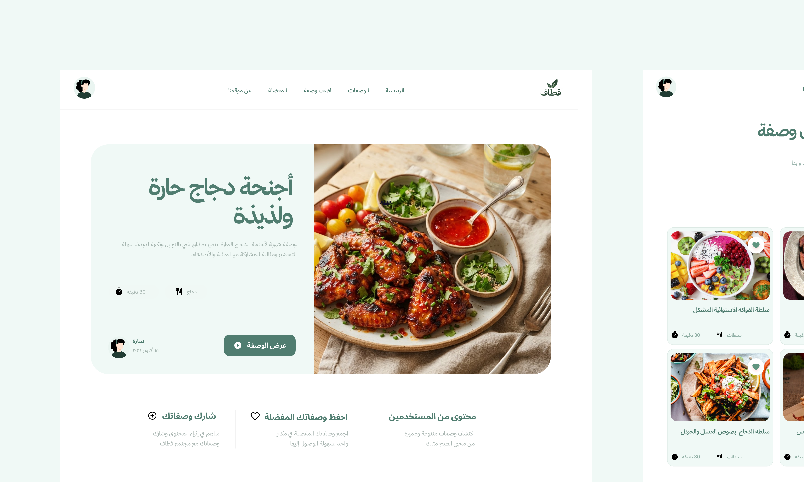

#  Qitaf | قطاف
### Recipe Website — UI/UX Design

**Personal Project · Figma · Arabic RTL Design**

## ✦ About the Project

**Qitaf** is a personal UI/UX design project for an Arabic recipe-sharing website. Designed in Figma, it provides a clean and intuitive experience for discovering, saving, and sharing recipes.

## ✦ Key Features

- **Recipe discovery and browsing** — explore recipes through a clear, organized interface.
- **Detailed recipe pages** — view recipe information and cooking instructions.
- **Favorite recipes** — save recipes for easy access.
- **Recipe submission** — share recipes through a dedicated form.
- **User profiles and account creation** — manage account details and preferences.

## ✦ Design & Tools

**Figma** · **UI/UX Design** · **Arabic RTL Layout** · **Interactive Components**

> This is a **UI/UX design concept**, not a coded website. Interactive components were created in Figma.

## ✦ Explore the Design

[**View on Figma ↗**](https://www.figma.com/design/mIpG0Sjy92SWItOHPIVM6O/Qitaf-%7C-%D9%82%D8%B7%D8%A7%D9%81-%E2%80%94-Recipe-Website-UI-UX-Design?node-id=1-296&t=7nb5f7F5qvBtylIh-1)
